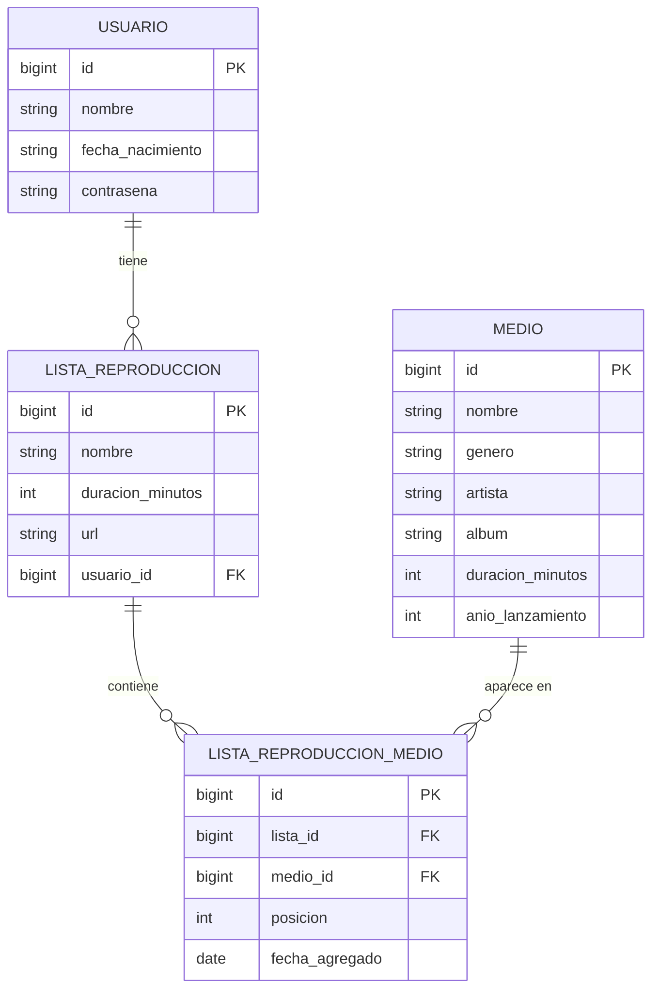
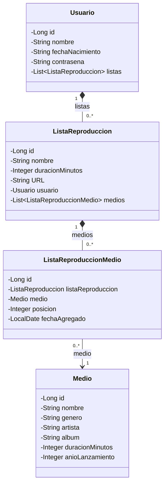

# Servicio de música

**Proyecto final de Implementación de Sistemas**: API REST desarrollada con Spring Boot para gestionar usuarios, sus listas de reproducción y el catálogo de medios (canciones) de un servicio de música.

## Descripción general

Este proyecto es una aplicación de backend desarrollada en **Spring Boot** que expone una **API REST** para administrar los usuarios de un servicio de música, sus listas de reproducción y el catálogo de medios. Los datos se almacenan en **PostgreSQL** mediante **Spring Data JPA**.

El catálogo se organiza por géneros musicales principales (por ejemplo, Electrónica, Rock y Jazz). Para extenderlo se aplicará el patrón de diseño **Decorator**, que permite añadir responsabilidades y características adicionales a un género base de forma dinámica, sin alterar su estructura central. Con esto se busca que las reglas de negocio del sistema sean flexibles y fáciles de ampliar.

> **Estado actual:** el proyecto cuenta con el modelo de datos, las relaciones entre entidades y el CRUD de usuarios, listas de reproducción y medios. La autenticación, las búsquedas avanzadas, el patrón Decorator y el monitoreo con Actuator están pendientes (ver [Requerimientos](#requerimientos) y [Próximos pasos](#próximos-pasos)).

## Integrantes del equipo

- Flores Carmona Iker Jair
- Morgado Ferreyra Dana Victoria
- Pérez Herrejón Angeli Nicole

## Tecnologías

| Tecnología | Uso en el proyecto |
|------------|--------------------|
| Java 25 | Lenguaje de programación |
| Spring Boot 4.2.0 (snapshot) | Framework base de la aplicación |
| Spring Web MVC | API REST y controladores |
| Spring Data JPA (Hibernate) | Persistencia y repositorios |
| PostgreSQL | Base de datos relacional |
| Maven (wrapper `mvnw`) | Construcción y dependencias |
| Lombok | Dependencia incluida en el proyecto |
| Dev Container | Entorno de desarrollo reproducible |
| Mermaid | Diagramas de la documentación |

## Requerimientos

| Requerimiento | Descripción | Estado | Notas |
|---------------|-------------|--------|-------|
| REQ_1 | La aplicación permite registrar un nuevo usuario con correo y contraseña seguros. | 🟡 Parcial | `POST /api/usuarios` crea usuarios y la contraseña nunca se devuelve en las respuestas. Falta el campo `correo` y cifrar la contraseña, que hoy se guarda sin cifrar. |
| REQ_2 | La aplicación permite iniciar sesión mediante credenciales válidas (correo y contraseña). | ⏳ Pendiente | Requiere agregar Spring Security. |
| REQ_3 | La aplicación permite consultar y descargar las listas de reproducción creadas por el usuario. | 🟡 Parcial | Se consultan con `GET /api/listas` y `GET /api/usuarios/{id}`, que incluye las listas del usuario. Falta la descarga y filtrar por el usuario con sesión iniciada (depende de REQ_2). |
| REQ_4 | La aplicación permite realizar búsquedas avanzadas de géneros, nombres de canciones, artistas y álbumes. | ⏳ Pendiente | Hoy solo hay listados y consulta por identificador. Artista, álbum y género son texto dentro de `Medio`. |
| REQ_5 | La aplicación permite al usuario crear, consultar, actualizar y eliminar sus listas de reproducción personalizadas. | 🟡 Parcial | El CRUD de listas está en `/api/listas`. Falta agregar y quitar medios de una lista ya creada, porque la actualización no modifica su contenido. |

Estados: ✅ implementado, 🟡 parcial, ⏳ pendiente.

## Funcionalidades

| Funcionalidad | Tecnología | Descripción | Estado |
|---------------|------------|-------------|--------|
| Gestión de la base de datos | Spring Data JPA y PostgreSQL | Almacena y consulta usuarios, listas de reproducción y medios. El esquema se genera a partir de las entidades (`ddl-auto=update`). | ✅ Implementada |
| Relaciones entre entidades | JPA (`@OneToMany` y `@ManyToOne`) | Un usuario tiene muchas listas, y cada lista contiene medios mediante la entidad intermedia `ListaReproduccionMedio`. Se documentan en [Modelo de datos y relaciones](#modelo-de-datos-y-relaciones-fase-4). | ✅ Implementada |
| Servicios REST | Spring Web | CRUD completo de usuarios, listas de reproducción y medios, con respuestas en JSON. | ✅ Implementada |
| Seguridad y autenticación | Spring Security | Proteger el acceso, cifrar las contraseñas y permitir el inicio de sesión. | ⏳ Pendiente |
| Búsquedas avanzadas | Spring Data JPA | Buscar por género, nombre de canción, artista y álbum. | ⏳ Pendiente |
| Catálogo por géneros con Decorator | Patrón de diseño | Añadir características a un género base sin modificar su estructura. | ⏳ Pendiente |
| Monitoreo y logs | Spring Boot Actuator y Logback | Consultar el estado de salud de la aplicación y registrar actividad y errores. Logback ya viene incluido en Spring Boot y escribe en consola; falta agregar Actuator. | ⏳ Pendiente |

## Avance del proyecto

| Fase | Contenido | Estado |
|------|-----------|--------|
| Fase 1 | Entorno de desarrollo (Dev Container), proyecto base con Spring Initializr y primer controlador de prueba (`/hello`). | ✅ Completada |
| Fase 2 | Persistencia con Spring Data JPA y PostgreSQL (laboratorio de Spring JPA). | ✅ Completada |
| Fase 3 | Modelos `Usuario`, `ListaReproduccion` y `Medio`, con sus repositorios y controladores CRUD. | ✅ Completada |
| Fase 4 | Relaciones 1 a muchos, colecciones anidadas, corrección del ciclo infinito en JSON y documentación con diagramas Mermaid. | ✅ Completada |

## Estructura del proyecto

```text
aspirest/
├── pom.xml
└── src/main/
    ├── java/aspirest/
    │   ├── AspirestApplication.java
    │   ├── HelloWorld.java
    │   ├── controller/   UsuarioController, ListaReproduccionController, MedioController
    │   ├── models/       Usuario, ListaReproduccion, ListaReproduccionMedio, Medio
    │   └── repo/         UsuarioRepository, ListaReproduccionRepository, MedioRepository
    └── resources/
        └── application.properties
```

## Endpoints disponibles

| Recurso | Métodos y rutas | Descripción |
|---------|-----------------|-------------|
| Prueba | `GET /hello` | Comprueba que la aplicación responde. |
| Usuarios | `GET` y `POST /api/usuarios` | Lista usuarios (con sus listas) y crea uno nuevo. |
| | `GET`, `PUT` y `DELETE /api/usuarios/{id}` | Consulta, actualiza o elimina un usuario. |
| Listas de reproducción | `GET` y `POST /api/listas` | Lista las listas y crea una nueva (requiere indicar su usuario). |
| | `GET`, `PUT` y `DELETE /api/listas/{id}` | Consulta, actualiza o elimina una lista. |
| Medios | `GET` y `POST /api/medios` | Lista el catálogo y agrega un medio. |
| | `GET`, `PUT` y `DELETE /api/medios/{id}` | Consulta, actualiza o elimina un medio. |

## Cómo ejecutar el proyecto

**Requisitos:** Java 25 (incluido en el Dev Container) y una base de datos PostgreSQL.

1. **Crear la base de datos.** La aplicación se conecta a `db:5432` con la base, el usuario y la contraseña `musica` (configurados en `aspirest/src/main/resources/application.properties`). En PostgreSQL ejecuta:

   ```sql
   CREATE USER musica WITH PASSWORD 'musica';
   CREATE DATABASE musica OWNER musica;
   ```

   Si tu PostgreSQL está en otro equipo, cambia `db` por su dirección en `spring.datasource.url`.

2. **Iniciar la aplicación:**

   ```bash
   cd aspirest
   ./mvnw spring-boot:run
   ```

3. **Probar la API** (la aplicación escucha en el puerto `8080`):

   ```bash
   # Crear un usuario
   curl -X POST http://localhost:8080/api/usuarios -H "Content-Type: application/json" \
     -d '{"nombre":"Angeli","fechaNacimiento":"2000-05-04","contraseña":"1234"}'

   # Crear una lista de reproducción para el usuario 1
   curl -X POST http://localhost:8080/api/listas -H "Content-Type: application/json" \
     -d '{"nombre":"Favoritas","duracionMinutos":45,"usuario":{"id":1}}'

   # Consultar los usuarios con sus listas
   curl http://localhost:8080/api/usuarios
   ```

> **Nota:** el Dev Container del repositorio todavía no incluye el servicio de PostgreSQL, por lo que la base de datos debe estar disponible por separado.

## Próximos pasos

1. Agregar Spring Security: inicio de sesión (REQ_2), campo `correo` y contraseñas cifradas (REQ_1).
2. Implementar las búsquedas avanzadas por género, canción, artista y álbum (REQ_4).
3. Crear las entidades `Artista`, `Album` y `Genero`, hoy guardadas como texto dentro de `Medio`.
4. Aplicar el patrón Decorator al catálogo de géneros musicales.
5. Agregar Spring Boot Actuator y configurar los registros (logs) de la aplicación.
6. Agregar endpoints para añadir y quitar medios de una lista existente (REQ_5) y para descargar listas (REQ_3).
7. Incluir PostgreSQL en el Dev Container para que cualquier integrante pueda ejecutar el proyecto sin configuración manual.

## Modelo de datos y relaciones (Fase 4)

### 1. Relaciones 1 a muchos identificadas

| # | Relación | Lado "uno" | Lado "muchos" | Llave foránea | Obligatoria |
|---|----------|------------|---------------|---------------|-------------|
| 1 | Un usuario tiene muchas listas de reproducción | `Usuario` | `ListaReproduccion` | `lista_reproduccion.usuario_id` | Sí |
| 2 | Una lista contiene muchas entradas de lista | `ListaReproduccion` | `ListaReproduccionMedio` | `lista_reproduccion_medio.lista_id` | Sí |
| 3 | Un medio aparece en muchas entradas de lista | `Medio` | `ListaReproduccionMedio` | `lista_reproduccion_medio.medio_id` | Sí |

Una lista puede tener muchos medios y un medio puede estar en muchas listas (relación muchos a muchos). Para modelarla solo con relaciones 1 a muchos se usa la entidad intermedia `ListaReproduccionMedio`, que además guarda la `posicion` del medio dentro de la lista y la `fechaAgregado`. Una restricción única sobre `(lista_id, medio_id)` evita repetir el mismo medio en una lista.

Las demás relaciones del dominio involucran a `Medio` (`artista`, `album` y `genero`), que hoy están guardados como texto. Quedan pendientes hasta que existan sus entidades propias:

- Un `Artista` tiene muchos `Album`.
- Un `Album` tiene muchos `Medio`.
- Un `Genero` tiene muchos `Medio`.

### 2. Diagrama entidad-relación



En la base de datos las columnas son `contraseña` y `año_lanzamiento`; en el diagrama se escriben sin tilde ni eñe solo para que Mermaid pueda dibujarlas.

### 3. Diagrama de clases

Cada lado "uno" guarda una colección (`List`) de objetos del lado "muchos", y cada lado "muchos" guarda la referencia a su padre.



Las dos primeras relaciones se dibujan como composición (rombo relleno) porque se configuró `cascade = ALL` y `orphanRemoval = true`: al eliminar un usuario se eliminan sus listas, y al eliminar una lista se eliminan sus entradas, pero nunca los `Medio`, que siguen existiendo en el catálogo.
