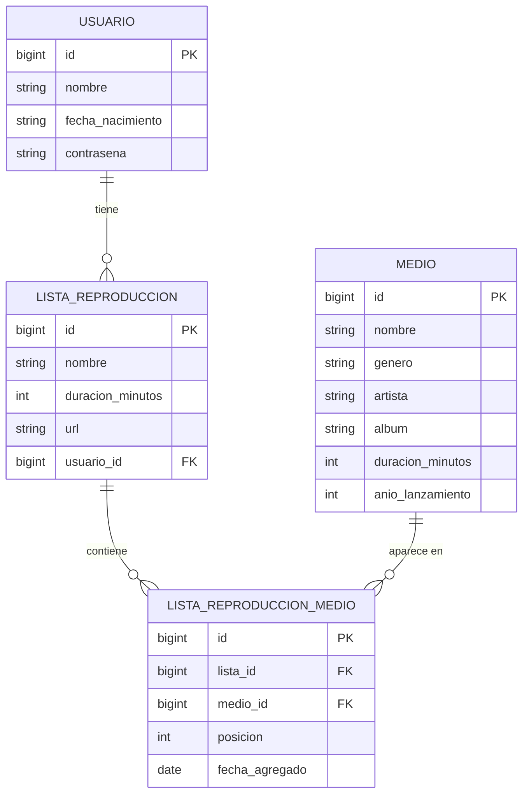
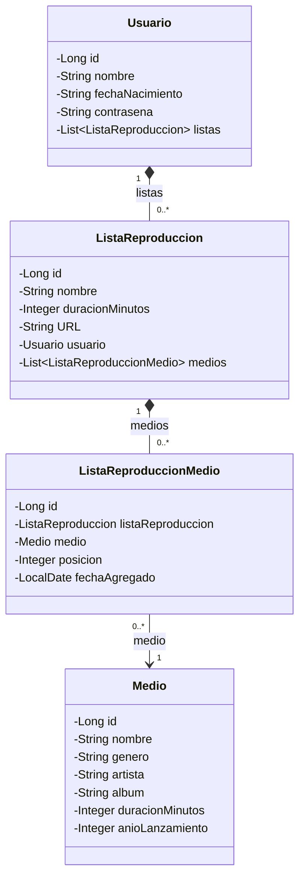

# PROYECTO-FINAL-
==DESCRIPCIÓN GENERAL DEL PROYECTO==

Este proyecto es una aplicación de backend desarrollada en Spring Boot para la gestión de un servicio de música, estructurando mediante catálogos organizados por géneros musicalesprincipales (por ejemplo; Electrónica, Rock, Jazz). Para ello utilizaremos el patrón Decorator, el cual permite añadir responsabilidades y características adicionales d emanera dinámica sobre cualquier género musical base sin alterar su estructura central, logrando una alta flexibilidad y extensibilidad en las regla de negocio del sistema.

==Lista de Integrantes del equipo== 
Flores Carmona Iker Jair
Morgado Ferreyra Dana Victoria 
Pérez Herrejón Angeli Nicole

==Tabla de requerimientos== REQUERIMIENTOS

REQUIRIMIENTO DESCRIPCIÓN 
REQ_1 La aplicación permite crear un - nuevo usuario con correo y contraseña - seguros.

REQ_2 La aplicación permite iniciar sesión - mediante credenciales válidas (correo - y contraseña).

REQ_3 La aplicación permite descargar y - consultar playlist creadas por el - usuario.

REQ_4 La aplicación permite realizar - búsquedas avanzadas de géneros, _ nombres de canciones, artistas y _ álbumes.

REQ_5 La aplicación permite al usuario _ crear, actualizar, editar y eliminar _ sus playlists personalizadas.

== Lista de Funcionalidades==

*Gestion de Base de Datos (Spring Data JPA junto con PostgreSQL) Almacenar y consultar los datos de los usarios, canciones, artistas, álbumes y playlist.

*Seguridad y Autentificación de Usuarios (Spring Security) Proteger los accesos, cifrar contraseñas de registro e inico de sesión.

*Servicios (API REST, Spring Web) Permitir la comunicación entre el backend y los clientes (búsquedas de canciones, creación de playlists, etc).

*Logs (Spring Boot Actuator y Logback) Monitorear el estado de salud fr la aplicación y resgistrar logs de actividad o errores del servidor.

**MODELO DE DATOS Y RELACIONES (FASE4)
 
    Relaciones 1 a muchos identificadas 
#       Relacion                                                    
1      Un usuario tiene muchas listas de reproduccion. 
      -||---------------------------------------------------|<-
      USUARIO                                    ListaReproduccion
#  LADO UNO        LADO "muchos"       FK                   Obligatoria
Usuario           ListaReproduccion   lista_reproduccion_   Si/Fuerte
                                      usario_id

2  Una lista contiene muchas entradas de lista 
--||---------------------------------------------------------|<--
ListaReproduccion                              ListaReproduccionMedio
# LADO UNO         LADO "muchos"        FK                  Obligatoria 
ListaReproduccion  ListaReproduccion   Lista_reproduccion_   Si/Fuerte
                    Medio              medio.lista_id

3 Un medio aparece en muchas entradas de lista 
----||-------------------------------------------------------|<---
Medio                                          ListaReproduccionMedio
# LADO UNO      LADO "muchos"         FK                 Obligatoria 
Medio       ListaReproduccionMedio   lista_reproduccion_   Sí/Fuerte
                                    medio.lista_id

Una lista puede terne rmuchos medios y un medio puede estar en muchas listas (relación muchos a mucos). Para modelarla solo con relaciones 1 a muchos se usa la entidad intermedia ListaReproduccionMedio, que ademas guarda la posicion del medio dentro de la lista y la fechaAgregado. Una restricción única sobre (lista_id, medio_id) evita reperir el mismo medio en una lista. 

Las demas relaciones que contendrian Medio (artista, album y genero). Quedan pendienres hasa que existan sus entidades propias:
    *Un ARTISTA tiene mcuhos Album 
    *Un ALBUM tiene muchos Medio.
    *Un GENERO tiene muchos Medio. 

# DIAGRAMA ENTIDAD- RELACION 

En la base de datos las columnas son `contraseña` y `año_lanzamiento`; en el diagrama se escriben sin tilde ni eñe solo para que Mermaid pueda dibujarlas.

### 3. Diagrama de clases

Cada lado "uno" guarda una colección (`List`) de objetos del lado "muchos", y cada lado "muchos" guarda la referencia a su padre.

Las dos primeras relaciones se dibujan como composición (rombo relleno) porque se configuró `cascade = ALL` y `orphanRemoval = true`: al eliminar un usuario se eliminan sus listas, y al eliminar una lista se eliminan sus entradas, pero nunca los `Medio`, que siguen existiendo en el catálogo.

### 4. Cómo quedó en el código

- **Lado "uno":** `@OneToMany(mappedBy = "...", cascade = CascadeType.ALL, orphanRemoval = true)` sobre una `List` inicializada vacía (`Usuario.listas` y `ListaReproduccion.medios`).
- **Lado "muchos":** `@ManyToOne(optional = false)` con `@JoinColumn(name = "...")`, que define la llave foránea (`usuario_id`, `lista_id` y `medio_id`).
- **Serialización JSON:** `@JsonManagedReference` y `@JsonBackReference("lista-medios")` en la relación lista-entradas, y `@JsonIgnoreProperties` en `ListaReproduccion.usuario`, para no generar un ciclo infinito.
- **Contraseña:** `Usuario.contraseña` es de solo escritura (`WRITE_ONLY`), así que se acepta al crear el usuario pero nunca se devuelve en las respuestas.
- `ListaReproduccion` ya no guarda el nombre del usuario como texto: lo reemplaza la relación con `Usuario`.